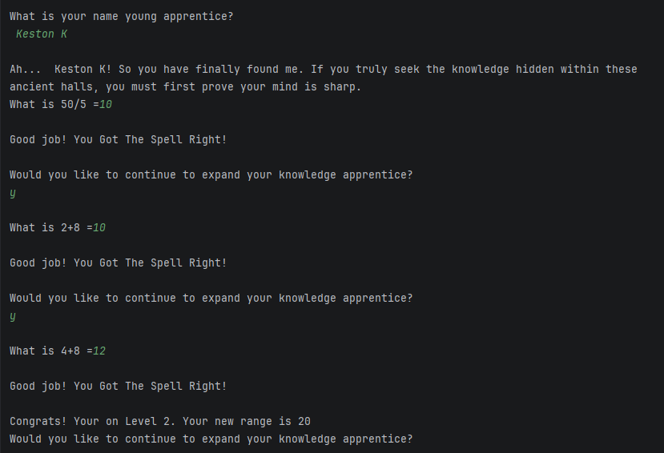
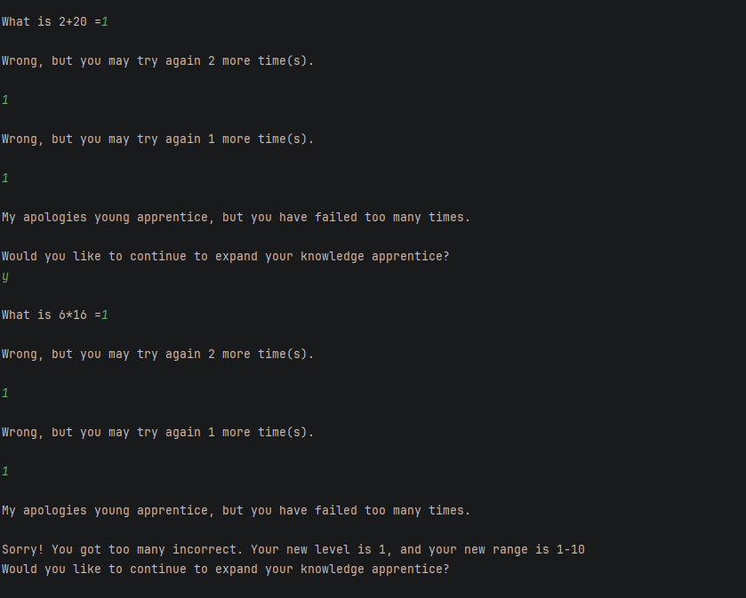
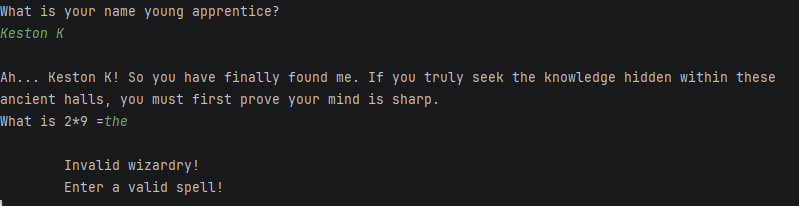
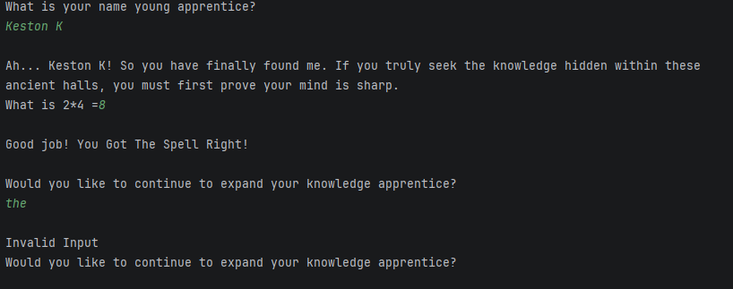

<b>Table of Content</b>
- [Summary](#summary)
- [Maintainers](#maintainers)
- [New Concepts Used](#new-concepts-used)
- [Console Output Example](#console-output-example)

## Summary
This is a math tutoring program themed around wizards/magic.
- Displays the wizard themed program header
- Says some magic/wizard jokes
- If there's an error it ends, but if there isn't it continues with the functionality
- Gets the user's full name and welcomes user
- Displays any amount of randomly generated math problems
- Gets the user's answer and checks if it's a valid number
- User gets 3 attempts for each question
- If the user gets 3 problems right, they level up and it adds 10 to the range of values the numbers can be
- If the user is on a level higher than 1, and gets 3 problems incorrect, they level down and decrease the range by 10
- Says goodbye to the user

## Maintainers
[@bendickinson15](https://github.com/bendickinson15) Benjamin Dickinson  
[@kestonkrup24](https://github.com/kestonkrup24) Keston Krupicka

## New Concepts Used
- Enum data type
- Do-while, while, and for loop iteration
- Converting strings to lowercase
- Constant variables

## Console Output Leveling Up Example:

## Console Output Leveling Down Example:

## Console Output Invalid Numeric Input Example:

## Console Output Invalid Yes or No Input Example:

[Back to Top](#math-tutor-v1)
